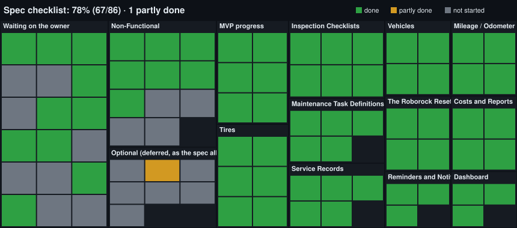

# OnlyCars: Requirements Checklist

One line per requirement in `docs/spec.md`. Updated after every ticket is signed off. Evidence and details are in `docs/requirements-status.md`.

**Last updated:** 2026-10-15, SET-1 backend done (settings API: language, theme, currency); frontend next
**Progress:** 14 of 50 required items done, 8 partly done, 28 not started. The 7 optional items are not counted.

Legend:
- `[x]` done: works end to end in the UI, in Hebrew and English, and is tested.
- `[~]` partly done: what's missing is in *italics*.
- `[ ]` not started.
- 🔨 being built now.

<!-- progress:start (generated by scripts/checklist-progress.mjs) -->

**Progress:** 17 of 66 done (26%), 8 partly done, 41 not started.
<!-- progress:end -->

## MVP progress
- [x] **Step 1: Accounts, cars, odometer.** Done (MVP1-A, B and C signed off), apart from the gaps marked below. 🔨 Next: SET-1, the settings screen (language, theme, currency), then SET-2 (km/miles).
- [x] **Step 2: Maintenance tasks, templates, Reset.** Done (MVP2-A, B and C signed off).
- [ ] **Step 3: Service history with costs**
- [ ] **Step 4: Dashboard with due and overdue status**
- [ ] **Step 5: Checklists, then tires, then reports and notifications**
- [x] **Before going online: SEC-1** (limit login attempts, account lockout, constant-time login). Signed off.

## 1. Vehicles
- [x] Add, edit and archive cars, keeping their history
- [~] Fields: nickname, make, model, year, VIN, plate, fuel type, purchase date, photo. *Missing: photo upload, which needs Cloudflare R2 set up.*
- [x] Current odometer, with a history of readings, which you can edit and delete
- [x] Multiple cars per account

## 2. Mileage / Odometer
- [~] Manual odometer updates with a quick-entry button. *Works on the car list and car page; the dashboard doesn't exist yet.*
- [~] Auto-log the odometer when a service is recorded. *Mark done logs a "Service" reading. Missing: the full service record form (step 3).*
- [~] Average km/day, used to predict due dates. *Calculated and shown. Not used for predictions yet; that comes with the dashboard or later.*
- [~] Km/miles unit, and a currency per user. *Currency is chosen at sign-up. Missing: a km/miles setting (SET-2) and a way to change the currency later.* 🔨 SET-1

## 3. Maintenance Task Definitions
- [x] Task name and category
- [x] Interval by km, by time, or both (whichever comes first)
- [x] Starter template library, fully editable (12 templates; the owner should review their intervals)
- [x] Custom tasks per car
- [x] Turn a task off without deleting it

## 4. The "Roborock" Reset
- [x] Remaining km and days, a progress bar, and status: OK, Due soon, Overdue
- [x] Reset / Mark as done (records odometer and date, restarts the countdown, creates a history entry with optional cost and notes)
- [x] Undo for accidental resets (right after the reset; undo from the history comes in step 3)
- [x] Configurable "due soon" threshold (percent, 1 to 50)

## 5. Service Records
- [ ] Date, odometer, shop or DIY, total cost, notes
- [ ] Line items: part, brand, part number, quantity, unit cost, labour
- [ ] Attachments: receipt photos, PDFs, invoices
- [ ] Filter and search by car, task, date or shop
- [ ] Edit and delete past records

## 6. Tires
- [ ] Tire sets: brand, model, size, season, purchase year, DOT code
- [ ] Which set is on which car, with mount and unmount dates
- [ ] Km driven per set, calculated automatically
- [ ] Pressure log, tread depth log, rotation tracking
- [ ] Storage notes for the off-season set

## 7. Inspection Checklists
- [ ] Checklist templates
- [ ] Items: checkbox, number or text
- [ ] Schedule by km, by time, or manual only
- [ ] Run a checklist: tick items, add notes or photos, flag issues
- [ ] Failed items create a to-do or a maintenance task
- [ ] Run history per car

## 8. Costs and Reports
- [ ] Cost per car, per category, per month and per year
- [ ] Cost per km and total cost of ownership
- [ ] Charts: spending over time, cost by category
- [ ] Export to CSV and PDF

## 9. Reminders and Notifications
- [ ] Email (and optional push) when a task is due soon or overdue
- [ ] Non-mileage reminders: insurance, inspection, registration, licence
- [ ] Snooze, and a configurable lead time

## 10. Dashboard
- [ ] All cars at a glance, next due items sorted by urgency
- [ ] Overdue count and monthly spend summary
- [ ] Quick actions: update odometer, reset a task, start a checklist

## 12. Non-Functional
- [x] Email/password login *(optional Google login: not started)*
- [~] Mobile-first and installable as an app. *Mobile layout is done (44px tap targets, no sideways scrolling). Missing: proper app icons, and a verified install.*
- [~] Light and dark mode. *Follows the system setting. Missing: an in-app switch.* 🔨 SET-1
- [~] Each user's data is private, plus data export and delete-account. *Privacy is done and tested. Missing: export and delete-account.*
- [x] Hebrew and English, including right-to-left
- [ ] Receipt image storage with size limits (needs Cloudflare R2)
- [ ] Offline odometer entry that syncs later

## 11. Optional (deferred, as the spec allows)
- [ ] Fuel log and consumption tracking
- [ ] Issue / to-do list
- [ ] Shared access (partner or family)
- [ ] Garage directory
- [ ] Parts and warranty tracking
- [ ] Full data import/export
- [ ] OBD-II / manufacturer API odometer

## Waiting on the owner
- [ ] Create a Cloudflare R2 bucket and access key. This blocks car photos and receipts.
- [ ] Review the delegated decisions in `docs/decisions.md`, especially the 12 starter task intervals, the task status rules (when a task counts as "Due soon" or "Overdue"), the Reset and Undo rules (a one-tap reset counts as DIY; Undo only for the latest reset of a task), and the new settings rules (changing the currency does not convert old amounts; only ILS, USD, EUR and GBP).
- [ ] Create an Azure account, when it's time to deploy.
